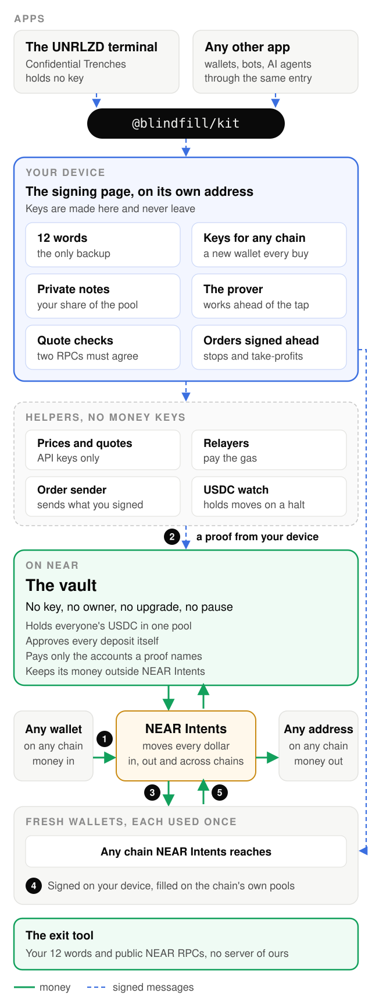

Blindfill is the private engine without limit and compromise for every app: wallets, terminals, bots and AI agents plug in and trade as strangers.


# Confidential Trenches

[](https://github.com/UNRLZD/confidential-trenches/actions/workflows/ci.yml) [](LICENSE)

Private trading that nobody can rob, not even us

Blindfill sits under any wallet, terminal, trading bot or AI agent, and about 50 lines of code make its users strangers on chain.
Every chain NEAR Intents reaches can join, with fresh wallets of its own and the same private balance.
Any market with a pool on chain can trade privately, from memecoins to stock tokens, and money can leave to any address.

[The app](https://confidential.unrealized.trade) | [60-second video](<video link>) | [The vault on NEAR](https://nearblocks.io/address/<vault account>) | [Architecture](docs/architecture.md) | [Security](docs/security.md)

Blindfill is the engine. Its vault on NEAR has no key, and its wallets live on your device, where each one carries a single trade. Apps plug in through one public entry, `@blindfill/kit`.

Confidential Trenches is the flagship app on Blindfill, the experimental edition of the UNRLZD trading terminal. It calls the same public entry as any outside application would, and it never holds a key.

Built at NEAR HACKATHON, Nov 1-14, 2026.

## Why it stands apart

Private trading today asks you to trust someone with your money or your history, usually an operator who holds the keys and reads every transaction that passes through. We built Blindfill so that nobody holds either.

### Nobody can take the money

The vault has no access key, no owner, no upgrade path and no pause. Ask any NEAR RPC for its keys and you'll get `[]`. Money leaves only for a proof your device makes, and it goes only to the accounts named in that proof.

### No record ties a trade to you

Every buy comes from a wallet that has never been used, paid from a pool that every user shares, and nothing on chain records which deposit paid for which trade. Timing and amount can still hint. That's why the app buys in standard sizes and gets wallets ready before you need them.

### Private, at trading speed

Your device makes its proofs in the background, so a buy doesn't wait on a proof or a bridge. On a phone, a Solana buy filled in 1.2 s at the median and 3.3 s at p95, tap to filled, over five live runs.

### Any chain, one balance

Blindfill is built for any chain NEAR Intents reaches. Money comes in from any of them, and a fresh wallet trades any token with a pool there, all from one private balance.

### Orders with no key on our side

Your device signs the stop and the take-profit right after the buy, with the price written into each. Our server sends them when the price arrives and can't change a byte, and once one fills, its twin can't land.

### Out with only your 12 words

Switch off every server we run and the exit tool still brings your money home, using your 12 words and public NEAR RPCs.

## Try it

### Watch it run

<a recording of one private buy, from sign-in to Verify>

### For people

You need a phone or a computer, and money in any wallet.

1. Open [confidential.unrealized.trade](https://confidential.unrealized.trade).
2. Sign in with Face ID, a passkey or a wallet you already use.
3. Save your 12 words.
4. Deposit from any wallet, on any chain NEAR Intents reaches.
5. Buy any token. Open the trade on a block explorer: the buyer is a wallet that has never been used.
6. Tap Verify.
7. Withdraw to any address.

### Check it yourself, with no money

Plain reads from two public NEAR RPCs. No account, no key, no install beyond `curl` and `jq`.

```sh
VAULT=<vault account>
USDC=17208628f84f5d6ad33f0da3bbbeb27ffcb398eac501a31bd6ad2011e36133a1
for RPC in https://rpc.mainnet.fastnear.com https://rpc.mainnet.near.org; do
  q() { curl -s "$RPC" -H 'content-type: application/json' -d "{\"jsonrpc\":\"2.0\",\"id\":1,\"method\":\"query\",\"params\":$1}"; }
  # 1. the vault has no access key
  q "{\"request_type\":\"view_access_key_list\",\"finality\":\"final\",\"account_id\":\"$VAULT\"}" | jq -c .result.keys
  # 2. the code running is the code published here
  q "{\"request_type\":\"view_code\",\"finality\":\"final\",\"account_id\":\"$VAULT\"}" | jq -r .result.hash
  # 3. the vault holds every dollar it owes
  q "{\"request_type\":\"call_function\",\"finality\":\"final\",\"account_id\":\"$VAULT\",\"method_name\":\"totals\",\"args_base64\":\"e30=\"}" | jq -r '.result.result | implode'
  q "{\"request_type\":\"call_function\",\"finality\":\"final\",\"account_id\":\"$USDC\",\"method_name\":\"ft_balance_of\",\"args_base64\":\"$(printf '{"account_id":"%s"}' "$VAULT" | base64)\"}" | jq -r '.result.result | implode'
done
```

| Line | A passing read |
|---|---|
| 1 | `[]` on both RPCs |
| 2 | `<code hash>`, equal to the hash of `<the vault's reproducible build>` |
| 3 | the USDC balance equals what `totals()` says the vault owes |

### For AI agents and scripts

Node 24 or later and pnpm 10.33.1. Coding agents also read [AGENTS.md](AGENTS.md).

```sh
git clone https://github.com/UNRLZD/confidential-trenches
cd confidential-trenches
pnpm install --frozen-lockfile
pnpm -r --if-present --no-bail run test
```

A passing run of `pnpm -r --if-present --no-bail run test` ends with:

```text
# fail 0
```

The private buy calls only `@blindfill/kit`'s public entry, as any wallet, bot or agent would, and ends with:

```text
<the example's last lines>
```

## Live now

| Piece | Address | Explorer |
|---|---|---|
| The vault | `<vault account>` | `<NEAR explorer link>` |
| The app | `confidential.unrealized.trade` | `<release link>` |
| The signing page | `sign.confidential.unrealized.trade` | `<release link>` |
| The helper | `api.confidential.unrealized.trade` | — |

## How it works

One private buy, from the money coming in to the money going home. The step numbers match the diagram below, and every time in the last column comes from a measurement we ran.

| Step | What you do | What happens underneath | Measured |
|---|---|---|---|
| 1 Deposit | Send money from any wallet | NEAR Intents carries it into the vault's shared pool. Your device writes a private note. | about 40 s for NEAR Intents' part |
| 2 Prove | Nothing | Your device proves it owns a note without saying which. The proof fixes where the money goes, so the relayer carrying it can't redirect a cent. | 8.3 s on an iPhone, in the background |
| 3 Get ready | Nothing | The vault pays a standard size, and NEAR Intents moves it to a brand-new wallet whose key lives only on your device. | up to 39 s for NEAR Intents' part, before you tap |
| 4 Trade | Tap Buy | Your device checks the quote against two chain reads, signs, and the buy lands from a wallet with no history. Your stop and take-profit get signed right after. | 1.2 s median, 3.3 s p95, on a phone |
| 5 Come back | Sell, or withdraw | After a sell, the money returns to the vault as a fresh note. A withdrawal goes to any address on any chain. | |

## Performance

Every number below comes from a run we recorded, and each row links to the transactions behind it on a public explorer, so you can check a fill yourself. Rows signed by the test script used keys the script held; so far only the Solana buy and sell were signed in a phone browser. On release day the same runs go out from a phone on mainnet, on every chain, and this table is rebuilt from those records.

<!-- perf-table:begin (made by scripts/perf-table.mjs from perf/runs; do not edit by hand) -->
| Chain | What | Median / p95 | Filled | Where, signed by | Every transaction |
|---|---|---|---|---|---|
| Solana | Buy | 1.2 s / 3.3 s | 5 of 5 | mainnet, phone browser | [solana-phone-2026-10-26](docs/performance.md#solana-phone-2026-10-26) |
| Solana | Buy | 0.9 s / 1.2 s | 20 of 21 | mainnet, test script | [solana-script-2026-10-19](docs/performance.md#solana-script-2026-10-19) |
| Solana | Sell | 1.4 s / 1.5 s | 5 of 5 | mainnet, phone browser | [solana-phone-2026-10-26](docs/performance.md#solana-phone-2026-10-26) |
| Solana | Sell | 0.8 s / 1.0 s | 20 of 20 | mainnet, test script | [solana-script-2026-10-19](docs/performance.md#solana-script-2026-10-19) |
| Solana | Money in to NEAR Intents | 41.9 s | 1 of 1 | mainnet, test script | [solana-intents-2026-10-19](docs/performance.md#solana-intents-2026-10-19) |
| Solana | Money out to a fresh wallet (NEAR Intents) | 21.1 s / 22.7 s | 2 of 2 | mainnet, test script | [solana-intents-2026-10-19](docs/performance.md#solana-intents-2026-10-19) |
| Solana | Money out to a fresh wallet (NEAR Intents) | 38.9 s / 39.0 s | 2 of 2 | mainnet, test script | [solana-intents-out-2026-10-26](docs/performance.md#solana-intents-out-2026-10-26) |
| Base | Buy | 0.9 s / 1.3 s | 20 of 20 | mainnet, test script | [base-script-2026-10-20](docs/performance.md#base-script-2026-10-20) |
| Base | Sell | 1.2 s / 1.3 s | 20 of 20 | mainnet, test script | [base-script-2026-10-20](docs/performance.md#base-script-2026-10-20) |
| Base | Hop between chains (Relay) | 4.9 s / 5.8 s | 2 of 2 | mainnet, test script | [base-hop-2026-10-26](docs/performance.md#base-hop-2026-10-26) |
| Base | Money out to a fresh wallet (NEAR Intents) | 21.2 s | 1 of 1 | mainnet, test script | [base-intents-2026-10-19](docs/performance.md#base-intents-2026-10-19) |
| Robinhood | Buy | 1.9 s / 4.0 s | 20 of 20 | mainnet, test script | [robinhood-script-2026-10-20](docs/performance.md#robinhood-script-2026-10-20) |
| Robinhood | Sell | 2.0 s / 2.6 s | 20 of 20 | mainnet, test script | [robinhood-script-2026-10-20](docs/performance.md#robinhood-script-2026-10-20) |
| NEAR | Buy | 3.9 s / 4.3 s | 20 of 20 | mainnet, test script | [near-script-2026-10-20](docs/performance.md#near-script-2026-10-20) |
| NEAR | Sell | 3.7 s / 4.2 s | 20 of 20 | mainnet, test script | [near-script-2026-10-20](docs/performance.md#near-script-2026-10-20) |
| NEAR | Money in to NEAR Intents | 31.9 s | 1 of 1 | mainnet, test script | [near-intents-2026-10-19](docs/performance.md#near-intents-2026-10-19) |
| NEAR | Money out to a fresh wallet (NEAR Intents) | 24.4 s | 1 of 1 | mainnet, test script | [near-intents-2026-10-19](docs/performance.md#near-intents-2026-10-19) |
| NEAR | Withdraw proof on a phone | 8.3 s / 8.5 s | 5 of 5 | device, phone browser | [proof-phone-2026-10-26](docs/performance.md#proof-phone-2026-10-26) |
| NEAR | Commitment proof on a phone | 0.6 s / 0.7 s | 5 of 5 | device, phone browser | [proof-phone-2026-10-26](docs/performance.md#proof-phone-2026-10-26) |
| NEAR | Vault withdraw, the vault's own gas | up to 82.420 Tgas | 3 of 3 | testnet, test script | [vault-gas-testnet-2026-10-26](docs/performance.md#vault-gas-testnet-2026-10-26) |
| NEAR | Vault deposit, tree work only | up to 11.900 Tgas | 5 of 5 | testnet, test script | [vault-gas-testnet-2026-10-26](docs/performance.md#vault-gas-testnet-2026-10-26) |
<!-- perf-table:end -->

Medians round to the nearest 0.1 s. A p95 always rounds up.

## Architecture

<picture>
  <source media="(prefers-color-scheme: dark)" srcset="assets/architecture-dark.svg">
  
</picture>

Every box and arrow is explained in [docs/architecture.md](docs/architecture.md), and every party's view in [docs/security.md](docs/security.md).

## How this differs

We put the same six questions to each kind of private trading product on the market today.

| | Terminals that split trades over managed wallets | Private balances run by an operator | Shielded pools on one chain | Blindfill |
|---|---|---|---|---|
| Who can tie a trade to you | The operator | The operator | Timing and amount | Nobody holds the link. Timing and amount can hint. |
| Who can move or freeze the money | The operator | The operator, or a DAO | An upgrade key, in some | Nobody. The vault has no key. |
| Tokens minutes old | Yes, in public | No, a fixed list | Some | Yes, from a wallet never used |
| Chains to trade on | Several, in public | Many, inside one network | One | Any chain NEAR Intents reaches, from one balance |
| Wait at the tap | None | None | A shielding wait, in some | None. Wallets are ready before you tap. |
| Stops and limits while you sleep | Held on the operator's keys | Some | Rare | Signed on your device, with no key on our side |

## Who sees what

Nobody holds a record of which deposit paid for which trade. Your 12 words and wallet keys stay on your device, and the vault holds no key at all, so there's no master key for anyone to leak or be ordered to hand over.

| Who | Sees | Never sees |
|---|---|---|
| Anyone on chain | Money going into the vault, standard-size payouts to new wallets, those wallets trading, withdrawals going out | Which deposit paid for which wallet |
| NEAR Intents | Each move it carries, with its amount and both ends | Which note paid, or whose wallet it is |
| Our helper | Each request it carries, with its time and IP address: quotes, orders, proofs | Your keys, your 12 words, or which note a proof spends |
| The vault | A valid proof, the accounts it pays and the amount | Which deposit the proof spends |
| You | Everything | |

Two hints remain. On chain, the size and time of a move can suggest a link, and our helper sees each request's IP address and arrival time. Standard sizes and wallets readied early narrow both. The [security page](docs/security.md) goes party by party.

## The parts

| Part | What it does |
|---|---|
| The vault | A NEAR contract that holds everyone's USDC in one pool. Money leaves only for a proof made on the owner's device from their 12 words, and goes only to the accounts that proof names. It ports Privacy Pools v1, whose code is audited and open source, to NEAR, with its admin parts removed: the vault approves every deposit itself. Its balance rests on NEAR beside NEAR Intents, never inside it. |
| Fresh wallets | Brand-new wallets on any chain NEAR Intents reaches, each one used once, all from the same 12 words. Keys never leave the device, and any wallet that imports a private key opens them. |
| Orders signed in advance | Stops and limit sells are signed on the device with the price written in. A helper sends each one when its price is hit; it fills only at that price or better, into the user's own wallet. When one of a pair fills, the other cancels on its own. |
| The kit | `@blindfill/kit`, one public entry for any app: deposit, prove, ready the wallets, trade, set orders, withdraw, verify. About 50 lines make a private buy. |
| The terminal | The UNRLZD trading terminal, rebuilt on the kit. It calls only the kit's public entry, as any outside app would, and holds no key: a separate signing page on its own address signs every request. |
| Helper servers | Show prices and charts, carry signed messages and send orders signed in advance. They hold API keys, never a key to users' money. |

## What the vault can never do

- Sign anything with a key: it has none, and a read of its access keys returns `[]`.
- Change its code, pause, or change a setting: it has no owner, no upgrade path, no pause and no setter.
- Add a key, redeploy or delete itself: its code calls none of the functions that would.
- Pay any account the owner's proof does not name.
- Leave its balance inside NEAR Intents, where an outside party could freeze it.

## Layout

| Path | What |
|---|---|
| `contracts/vault/` | The vault, a Rust NEAR contract |
| `packages/kit/` | `@blindfill/kit`, the public entry for any app |
| `packages/kit/src/checks/` | The device's checks on every quote before it signs |
| `packages/wallet/` | Keys, notes and proofs on the device |
| `packages/signpage/` | The signing page, on its own address |
| `packages/exit/` | Money out with only the 12 words and public RPCs |
| `apps/terminal/` | The UNRLZD terminal |
| `apps/helper/` | The helper server: API keys, relays and signed orders, never a money key |
| `docs/` | The architecture and security pages |
| `scripts/ci/` | CI gates |
| `scripts/live-checks/` | A live check for each change, run after every deploy |

## Checks

`<n>` tests, all passing on every pull request.

| Run | Checks |
|---|---|
| `pnpm run check:imports` | No app reaches past the kit's public entry |
| `pnpm run test:gates` | Every CI gate refuses its planted case |
| `gitleaks dir . --config .gitleaks.toml --redact` | No secret in the tree |
| `node scripts/ci/money-gate.mjs --all` | Every money-path transaction reads back on two public RPCs |

## Prior work

Research and proofs from before Nov 1 are in `UNRLZD/confidential-trenches-proofs`, kept private. Blindfill builds on Privacy Pools (0xbow, Apache-2.0) and NEAR Intents.

## License

Apache-2.0, see [LICENSE](LICENSE).
