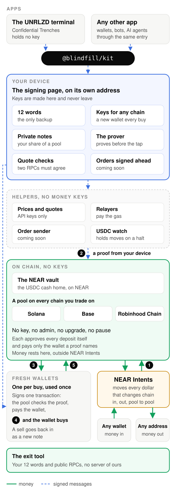

# Architecture

Blindfill is the engine: a vault on NEAR and a pool on each trading chain that nobody holds a key to, wallets whose keys exist only on your device, and an open kit that any app can call. Orders signed ahead of time are in its design, not in this build. Confidential Trenches is the flagship and experimental version of the UNRLZD terminal, built on that engine. Our terminal reaches Blindfill through the kit's one public entry and nowhere else, and CI fails the build the moment a file reaches past it.

Technical words are explained where they first show up. The app runs on mainnet today, and anyone can run the read-only check at the end of [Security](security.md) against live NEAR.

## The system on one page

<picture><source media="(prefers-color-scheme: dark)" srcset="../assets/architecture-dark.svg"></picture>

Solid green lines are money. Dashed blue lines are signed messages: requests that a key has already approved, which anyone can carry and nobody can change. Read it top to bottom.

Blindfill v2 runs on mainnet today with a pool on each chain you trade on, described next and in full in the [v2 lite paper](litepaper.md).

### v2: a pool on every chain you trade on

Crossing from the NEAR vault to a fresh wallet on another chain took up to 39.0 s in our recorded runs ([performance.md](performance.md#solana-intents-out-2026-10-26)) and left a public trail, so v2 puts the private crowd where the coins are. Each trading chain has a pool with the same proof design and the same rule as the vault: no admin, no upgrade, no pause.

| Pool | Mainnet address | What makes it keyless |
|---|---|---|
| Solana | `EN1Wb2iWTw7ihNHTNW3SU2DkUCbw7yEEGR7ywWgWn8MF` | The program has no upgrade authority (read on chain, 14 Nov 2026) |
| Base | `0xaa080e74ec99cf5c684548c77ca145edfcf899cf` | The contract's source has no owner, role, upgrade or pause |
| Robinhood Chain | `0x9306359433127c4f3be426f6faeb00a3c41f66db` | The same contract as Base |

A buy is proved on your device before you tap, naming a fresh wallet but no token. At the tap the fresh wallet signs one transaction: the pool checks the proof, pays the wallet, and the wallet buys. On NEAR there is no separate pool: the vault pays the fresh wallet, and the wallet then buys on Rhea, in two transactions. A sell puts the money back into the pool as a new note, on Base and Robinhood Chain through EIP-7702 in one transaction. The NEAR vault stays the USDC home and NEAR's own pool, and NEAR Intents still carries every dollar that changes chain. The deploy records are in [contracts/pool-solana/deployments/](../contracts/pool-solana/deployments/) and [contracts/pool-evm/deployments/](../contracts/pool-evm/deployments/).

Blindfill is designed for any chain NEAR Intents reaches. Because of the hackathon's time, this build integrates four chains: Solana, Base, Robinhood Chain and NEAR.

## The parts

### Your device

Everything that can move your money starts here. Your 12 words (a standard backup phrase) rebuild every key and every note on the device, so there's nothing else to back up.

A note is a sealed record that says "this much is mine". Only your 12 words can rebuild its secret, and the vault stores just its fingerprint. A proof is a short piece of math that says "I own one of the notes on the vault's public list and haven't spent it", without saying which one. Your device makes proofs in a background thread of the browser, checks every quote before it signs, and signs every trade. We hold none of that on any server of ours.

### The signing page

`confidential.unrealized.trade` is the signing page, on its own address. Keys are made there and stay there. The terminal runs inside it, in a frame served from `ct-app.unrealized.trade`. Because the browser treats the two addresses as separate places, the terminal can't read the page's storage. It sends the page requests such as "buy this" or "withdraw there". Anything that needs your full attention opens as a page of its own on this address: the passkey prompt, the screen that shows your 12 words, key export, the address for an outside withdrawal.

This is the one page that handles your keys, and the one we'd most like you to test. A release is built to come out byte for byte the same when built twice, with every file hashed and an outside check that compares what's served with the release. The exit tool below needs none of it.

### The terminal

`ct-app.unrealized.trade` shows the screens, the prices and the charts. It holds no key, no 12 words and no note secret. When you tap Buy, it hands a request to the signing page and waits.

### The kit

`@blindfill/kit` is the public entry. It offers deposit, prove, ready the wallets, trade, withdraw and verify. A wallet, a bot or an AI agent calls the same entry the terminal does, with no shortcuts. The device's checks live inside it: before anything is signed, a quote is compared with your own request and with pool reads from two RPC providers, which are public servers that answer questions about a chain. A server's word on a quote is never enough, so we don't sign on it. The reach check runs in CI today with 44 deep-import tests, so an app that goes around the entry fails the build.

### The helper

`ct-api.unrealized.trade` does five small jobs, and we've kept every key to anyone's money out of all five.

- The prices and quotes proxy keeps our vendor API keys, forwards requests and caches public data.
- The withdrawal relayer pays the NEAR fee and storage for a withdrawal. The proof fixes the recipient, the fee recipient and the fee, so the relayer can't redirect the money or take more.
- The deposit relayer prepays the vault's storage and submits your signed deposit. That deposit is a delegate action: a message your one-time account signs and someone else submits and pays for.
- The pool senders pay the network fee for each buy, sell and release a fresh wallet signs, and send it to its chain. The wallet signs the terms, so a sender can't change them.
- The USDC watch reads USDC's pause and blocklist state and its code hash, and holds moves while any of them is in doubt.

The order sender is part of the design, not of this build: the helper's health page reports it as `"orders":"down"`.

The helper's accounts hold our own gas, storage and fee money; none of their keys can move a user's money. Still, break into every one and the vault and the pools stay shut. What a broken-in helper can do is delay or refuse a quote, a buy, a sell or a withdrawal. That costs you time, and it's why the exit tool exists.

### The vault

A NEAR contract under `confidential.unrlzd.near`. It has no access key, no owner, no upgrade path, no pause and no setter. It holds everyone's USDC in one pool, a public list of note fingerprints, a list of spent marks, and a `totals()` method that reports what it owes.

Its code is a port of Privacy Pools v1, whose code is audited and open source. We removed two admin parts: the Entrypoint contract with its roles, and the outside list keeper who approves deposits. The vault approves every deposit itself. We wouldn't put money in a vault that only promises not to change, so ours has no way to. Our port gets its own review, since the audit belongs to Privacy Pools and doesn't cover what we changed. The vault pays only the accounts a proof names, and if a payment bounces it writes the money back as a new note that only your device can open.

### NEAR Intents

`intents.near` and its quoting service 1Click move every dollar: in from any chain NEAR Intents reaches, out to fresh wallets, back to the vault after a sell, and out to any address.

We keep the vault's resting balance outside `intents.near`, on purpose. The DAO behind `intents.near` holds roles that can lock an account, force-move a balance or force a withdrawal, and it can replace the contract's code. So the vault keeps its USDC as its own balance on the USDC token contract, and money sits inside `intents.near` for one hop at a time while it travels.

### Fresh wallets

Brand-new wallets on any chain NEAR Intents reaches. Each is used once: one arming funds one wallet, which makes one trade. All keys come from your 12 words on standard-shape paths and never leave the device, and any wallet that imports a private key opens them.

On Solana, Base and Robinhood Chain the pool pays a fresh wallet inside the buy, so the money arrives from the shared pool, not from you or from a wallet that's been used before. On NEAR the vault pays it. One thing is visible from outside. A buy from a set of wallets shows up as several fresh wallets buying the same token in the same second. Watchers can group them as one position and read its size. They can't tell whose it is.

### Orders signed in advance

Orders are Blindfill's design and not in this build: the app's order screens show Coming soon, and no exit is signed yet. This is how they are meant to work.

Right after a buy fills, your device signs the exits for that wallet, a stop and a take-profit. Each sells from the wallet and pays back to the same wallet, with its minimum out fixed in the signature: the amount sold, times the trigger price, less your own slippage. So an exit fills at your price or better, or it doesn't fill.

Our order sender holds the signed bytes and sends one when its price is hit. The stop and the take-profit share one nonce, a number a chain lets a wallet use once, so whichever lands makes the other invalid.

- On Solana the nonce is a durable nonce account. It stands in for the recent block hash, which means the signed exit doesn't go stale after about a minute.
- On EVM chains such as Base and Robinhood, it's the wallet's next nonce.
- On NEAR the exit is a delegate action with an expiry block height of its own, so it isn't cut off at the usual 14 hours.

Someone inside the helper can send an exit early, and it still fills at your price or better, into your own wallet, because price and destination sit inside the signature. Until it fills, an exit exists on no chain.

### The exit tool

`packages/exit` brings money home from the NEAR vault and the Solana pool with your 12 words and public RPCs, with no server of ours. For each, it asks two public RPCs and requires that they agree byte for byte. It rebuilds your notes from public data, makes the proof and submits the withdrawal, with no helper in the path. The Base and Robinhood Chain pools are not in it yet. The demo is meant to show it: every server we run switched off, and the 12 words still withdraw.

## The life of one private buy

How a buy runs in v2 on Solana, Base and Robinhood Chain. A buy on NEAR differs at step 4, as noted there.

1. Deposit. Send money from any wallet on any chain NEAR Intents reaches. 1Click delivers it to a one-time wallet whose key your device holds, on the chain whose pool it goes into, and that wallet deposits it in standard sizes, one note per size. Money into NEAR Intents took 31.9 s from NEAR and 41.9 s from Solana in our recorded runs ([performance.md](performance.md#near-intents-2026-10-19)). The commitment proof that goes with a note takes 0.6 s on an iPhone.
2. Prove. In the background your device picks a note and proves it, naming a brand-new wallet whose key only your device holds, but no token. One withdraw proof takes 8.3 s on an iPhone. We make it while you browse, never at the tap.
3. The tap. Your device reads the market on two RPC providers and checks the quote against your request. The fresh wallet signs one transaction, and the helper's pool sender sends it.
4. Paid and bought. In that one transaction the pool checks the proof and pays the fresh wallet, and the wallet buys. On NEAR the vault pays the fresh wallet first, and the wallet then buys on Rhea in a second transaction. A buy from a wallet readied ahead of time, the v1 way, took 1.2 s at p50 and 3.3 s at p95 from tap to filled on a phone over five live buys; the v2 buy hasn't been timed on mainnet yet.
5. Back. A sell puts the money back into the pool as a new note. Withdraw to any address, or through NEAR Intents to another chain, whenever you like.

The proof is why step 2 happens early. It takes 8.3 s on an iPhone, and a trade can't wait that long, so the wait moved out of the tap.

Checking one proof on NEAR costs 33.6 Tgas, about 0.003 NEAR. A whole withdrawal, with its update to the vault's note list, used 82.3 Tgas of the vault's own gas at the deepest tree we measured, about 0.008 NEAR ([g1-vault-gas](../research/proofs/g1-vault-gas/RESULT.md)).
