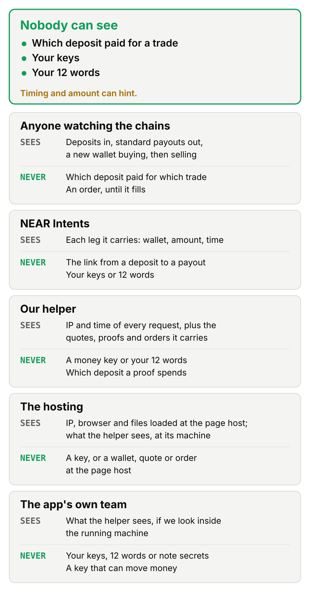

# Security

We assume the worst about everyone, ourselves included, and then ask what still holds. Parts built to behave a certain way are described as the design; the one thing you can run against live NEAR today is the read-only check at the bottom.

## The threat model

Picture an observer with every chain open in a tab, forever, and good analytics tools. Put NEAR Intents beside them, since it carries your money and sees every leg it carries. Then put our helper servers there too, broken into by someone with all the time they want, along with our own team and the companies that host our pages, all with bad intentions.

Two things have to survive that crowd. First, nobody can take your money or send it somewhere you didn't choose. Second, nobody can tie a deposit to a trade by reading chain data. The first is a hard property of the vault and the device. The second is a strong one with limits, and the limits are listed below.

## Who sees what

Three things nobody can see, us included:

- which deposit paid for which trade, because no record anywhere ties the two (timing and amount can hint, as What is not hidden explains);
- your keys, which exist only on your device;
- your 12 words, which never leave it either.

<picture><source media="(prefers-color-scheme: dark)" srcset="img/who-sees-what-dark.svg"></picture>

### Anyone watching the chains

They see your wallet paying in, the amount and the time. They see the vault holding a pool, standard-size payouts leaving it, and a wallet that has never been used buying a token. They watch that wallet sell and the money go back to the vault, and they see a withdrawal land at your address with its amount and time.

What they can't see is which deposit paid for which payout or trade. A proof says "one of the notes on the list is mine" and leaves it there. An order stays invisible until it fills, since a signed exit is only bytes in the order sender until it lands.

### NEAR Intents

Each leg it carries is visible to it: the wallet paying in and the amount, each payout's amount and new wallet, a return's amount, and the leg to another chain on a withdrawal.

The link between a deposit and a payout is not. That link would have to come from the vault, and the vault doesn't keep one. It never gets a key or your 12 words.

### Our helper

Every request shows it an IP and a time. It sees the quotes it proxies (token, size, your fresh wallet), each proof it carries with the recipient and fee, each signed deposit it submits, and each order it stores with wallet, size and trigger price.

It never gets a key to your money, your 12 words or a note secret, which means it can't tell which deposit a proof spends. A withdrawal can't be redirected by it, because the proof fixes the recipient. An order's price and destination are out of its reach too, since both sit inside the signature.

### The hosting

The company serving our pages sees each visitor's IP, browser, the files loaded and when. It also sees that a device fetched the proving files, which every signed-in device does in the background, so the download points at no one. The company running the helper's machine sees whatever the helper sees, live.

The page host never sees a wallet, a quote or an order, because those calls go to the helper and to the chains, not to the site. Neither company sees a key.

### The app's own team

We can see what the helper sees, if one of us looks inside the running machine. We hold the vendor API keys and a small gas balance, and that's all we hold.

Your keys, your 12 words and your note secrets are out of our sight. We have no key that moves money, so we can't move yours, and we can't add a key to the vault, change it or pause it. Trust in our code remains in one place, the signing page, and the section on what is not hidden covers it.

## What the vault can never do

### No key to sign with

The vault has no access key. We deploy it with no key added, and once an account has none, only the account itself can add one. A read of its access keys returns `keys: []`, and our live check is built to read that on two RPCs after every deploy.

### No way to change itself

No owner, no upgrade path, no pause, no setter. A keyless contract could still add a key or redeploy itself by calling itself, so we looked at that door too: its compiled code imports none of the host calls that add a key, deploy new code, stake or delete an account, and a test reads the import list to keep it that way.

<!-- Draft for the owner's docs pass (audit I-3): the words are not final. -->
That covers the vault's own code, and only that. The USDC inside it is Circle's, and Circle can pause the token or blocklist an account, the vault's included. A payout stopped that way isn't lost: its receipt fails, and the vault books the whole amount back as a refund note (`contracts/vault/src/payout.rs:146-147`). We run both cases in the sandbox on the real USDC code, a paused token and a blocklisted vault, and the notes and totals come out right (`contracts/vault/tests/s16.rs:409`, `:414`). The money still can't leave until Circle lifts the block, though, and we can't change that. The issuer's other powers are listed under [USDC has an issuer](#usdc-has-an-issuer) (audit I-3).

### No payout a proof doesn't name

Your device makes a proof that fixes the recipient, the fee recipient and the fee. Should a relayer edit any of the three, the proof fails and nothing moves. When a payment bounces, the money comes back as a new note that only your device can open.

<!-- Draft for the owner's docs pass (audit V-02, I-1): the words are not final. -->
If you write your own client, two things here are yours to get right. The kit already does both, so this is only for code that reads the vault directly. The kit's own notes ([packages/kit/README.md](../packages/kit/README.md)) carry these two and the pool rules beside the calls they qualify.

First, find a refund note through the spend that made it. Its precommitment won't do, because the vault doesn't reserve it, and only a deposit ever writes one (`contracts/vault/src/deposit.rs:144`). Once a withdrawal lands, a stranger can deposit 1 USDC on that refund precommitment. If the payout then bounces, two notes share one precommitment, and so one nullifier, and whichever is spent first strands the other for good. We take the note at the spend's own leaf (`packages/kit/src/vault/settle.ts:17-21`), and that rule is pinned by a test (`packages/wallet/test/note-restore.test.ts:888`; audit V-02).

Second, a USDC transfer event doesn't prove a payout arrived. NEAR keeps the logs of a receipt that failed, so when the recipient's transfer runs and the fee's transfer then fails, the logs still show USDC going to someone who was never paid. Read the vault's own `payout` event instead (`contracts/vault/src/payout.rs:150`), which says what was delivered and what came back, or the spend's status in `spends()` (audit I-1).

### No list keeper to wait on

Privacy Pools has a postman who approves each deposit from outside. We removed that role, and the vault approves every deposit itself, in the same call that records it. Nobody outside can hold a deposit back, and nobody outside can be bribed to wave a bad one through.

The code is a port of Privacy Pools v1, which is audited and open source. That audit belongs to Privacy Pools, so our port gets its own review.

## What is not hidden

### Timing and amount can hint

Anyone who reads the chain sees money go into the vault and standard-size payouts come out, and could try to match them by when and how much. Standard sizes narrow that, and so does readying wallets ahead of time. We don't put a number on how much. A buy from a set of wallets also shows several fresh wallets buying the same token in the same second, which watchers can group into one position and size.

### Our helper sees your IP and the time

What holds is narrower than "no one sees". The helper can't tell which deposit a proof spends, and it holds no key. Still, it could link a deposit and a withdrawal that arrive from the same IP close together in time, so the device is built to space the two apart and send them on separate connections. The helper's published code is built to keep no logs, but nothing yet proves that the running copy is the published one. With the helper off, your device calls public RPCs directly, and they see its IP next to its wallet.

### A broken-in helper can hold things back

It can drop or delay a quote, a withdrawal or an order, and withhold exits while your app is closed, so a stop may not fire. Redirecting money is the thing it can't do. If it simply stops, the exit tool brings your money home from the 12 words and public RPCs alone.

### The signing page is code you load from a server

Anyone who controls its hosting, certificate or domain could serve a page that reads your seed, and a passkey doesn't change that. The gap shrinks to one small page but doesn't close. We narrow it with builds that come out byte for byte the same, a published hash for every file, and an outside check that compares what is served with the release. Those are built to work that way, and the exit tool needs none of that page.

### USDC has an issuer

Since the vault holds USDC, the token's issuer can halt transfers, block an account or change the token's code, as for every USDC holder. That stops money and reveals nothing. We can't remove it. The helper's USDC watch is built to stop carrying moves if the token's code changes, until someone reads the change.

## Check it yourself

These are read-only reads against two public NEAR RPCs. They need no account, no key and no install beyond `curl` and `jq`, and the full script is in the [README](../README.md#check-it-yourself-with-no-money).

1. No access key. `view_access_key_list` on the vault's account must return `[]` on both RPCs.
2. The published code is the running code. `view_code` returns the hash of the deployed code. It must equal the hash of the vault you build yourself with `pnpm run build:vault`.
3. The vault holds what it owes. `totals()` on the vault reports what it owes. `ft_balance_of` on the USDC token for the vault's account must report the same amount.

Point it at any keyless account today and line 1 passes. Point it at the vault once it's deployed and all three should. If any line fails, the vault isn't what we say it is.
